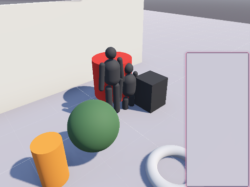
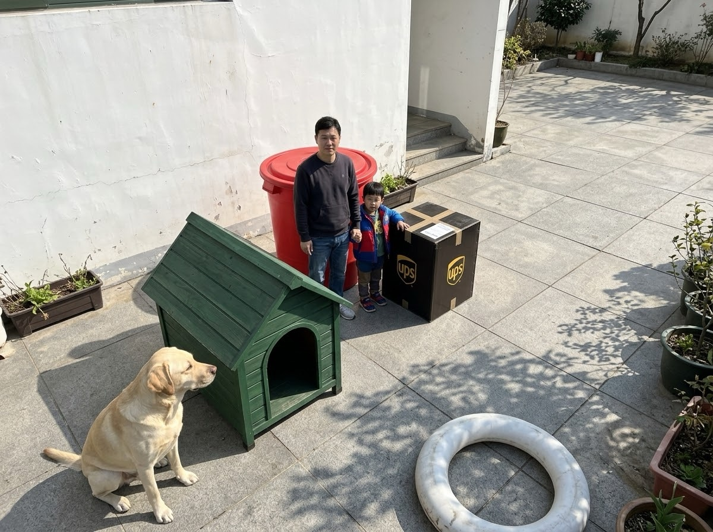
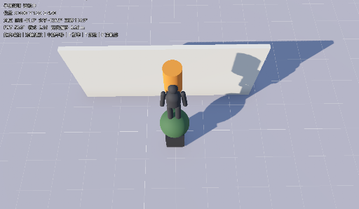
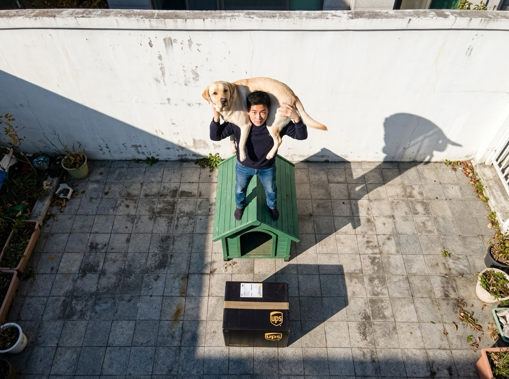

# ShotPilot

[繁體中文](README.md) | **English**

Use your phone as a virtual camera, "shoot" inside a simple 3D scene, and export camera-motion material for AI video generation (RGB + depth video + camera trajectory).

## Example: block out the shot with colored shapes, let AI paint it

Image and video models are hard to control with text alone — who stands where, and which angle the camera shoots from. ShotPilot lets you block out the scene with simple shapes first (each color stands for one thing), find the camera angle with your phone, then hand the screenshot (or the exported RGB / depth video) to the AI as a reference image, together with a prompt that explains the colors. Composition, placement, perspective and lighting direction all follow the scene.

### Example 1: a man and a child

| ShotPilot scene | AI result |
|---|---|
|  |  |

> Prompt: Generate an image based on this reference. The image shows an Asian man and a child. Green is a doghouse, yellow is a Labrador, black is a UPS shipping box.

The scene uses two mannequins (adult + child), a green sphere, a yellow cylinder and a black box. The red cylinder and white torus were not described, so the AI turned them into a red bucket and a swim ring on its own. The depth order of people and objects and the camera's downward angle match the scene.

### Example 2: standing on the doghouse with the dog over his shoulders

| ShotPilot scene | AI result |
|---|---|
|  |  |

> Prompt: Generate an image based on this reference. The image shows an Asian man. Green is a doghouse, yellow is a Labrador, black is a UPS shipping box. The dog is draped over the man's shoulders, and the man is standing on the doghouse.

This scene relies on **auto-ground**: drag the mannequin onto the green object and it stands on its top surface; the yellow cylinder lies across the mannequin's shoulders. The camera is a high-angle shot, and the direction of the shadows on the wall comes from the scene's sun angle.

### Workflow

1. **Block out**: add mannequins, boxes, spheres, etc. from "+ Add Object" and use colors to mark roles (e.g. green = doghouse, yellow = dog, black = box). The Presets tab applies a whole scene, lighting or camera angle in one click.
2. **Find the shot**: once the phone is connected, turning the phone turns the camera, crouching lowers it, and pinching changes the FOV. Or just use a camera preset.
3. **Render**:
   - Still image: capture the phone view (or call the MCP `screenshot` tool) as the reference image.
   - Video: record a take, or generate an "auto camera move" from waypoints, then export `rgb.mp4`, `depth.mp4` and `camera.json` for video-to-video, ControlNet depth or camera-control models.
4. **Write the prompt**: say who the subject is, then map every color to an object and describe how they relate (standing on, draped over the shoulders…).

```
┌──── Phone app (mobile) ──────┐            ┌──────── ShotPilot (desktop) ─────────┐
│ Gyro + gravity → camera angle │   pose     │ Scene editor: shapes, mannequins,     │
│ Vertical accel → crouch/stand │ ─────────► │   lights, GLB, environment            │
│ Dual joysticks, pinch FOV     │   JSON     │ PhoneCameraRig: drives camera, takes  │
│ Record / waypoint / auto /    │ ◄───────── │ Overview: frustum, trail, waypoints   │
│   playback                    │   JPEG     │ Export: RGB + depth mp4, camera.json  │
│ Full-screen live stream       │            │ StudioApi (127.0.0.1:8766) ◄ MCP ◄ AI │
└───────────────────────────────┘            └───────────────────────────────────────┘
   UDP 47011 broadcast auto-discovery (enter IP manually on iOS)      WebSocket :8765
```

## Layout

| Path | Description |
|---|---|
| `desktop/` | **ShotPilot** desktop app (Godot 4.7 project, main scene `studio/studio.tscn`) |
| `desktop/studio/` | Scene editor, exporter, waypoints, HTTP API for MCP, Live2D-style theme |
| `desktop/addons/phone_camera_rig/` | Plugin usable in any Godot project (PhoneCameraRig, PhoneCamOverview, editor dock) |
| `desktop/demo.tscn` | Minimal plugin demo (no editor) |
| `mobile/` | Phone-side Godot project; `ios_run.sh` installs to an iPhone in one step |
| `mcp/` | MCP server that lets AI control the Studio (see `mcp/README.md`) |

## Requirements

- Godot 4.7 (both desktop and phone sides are Godot projects)
- ffmpeg for mp4 export (`brew install ffmpeg`)
- Python 3.10+ for the MCP server (standard library only)
- An iOS 16+ or Android phone on the same LAN as the computer

## Quick start

1. Run `desktop` with Godot 4.7 (or open it in the editor and press F5).
2. Phone: install with `mobile/ios_run.sh` (for Android, export an APK from Godot), then connect to the `IP:8765` shown in the Studio over the same Wi-Fi.
   - `ios_run.sh` signs automatically with an App Store Connect API key: define `ASC_KEY_ID`, `ASC_ISSUER_ID` and `ASC_KEY_PATH` in `~/.config/shotpilot/asc-api.env`, and set `IOS_TEAM_ID` / `IOS_BUNDLE_ID` to your own Team / Bundle ID (also change `app_store_team_id` in `mobile/export_presets.cfg`).
3. Turning the phone turns the camera. The Studio main window is a fixed overview; the bottom-right inset shows what the phone sees.

## Phone controls

| Action | Effect |
|---|---|
| Rotate the phone | Camera angle (portrait = portrait camera; landscape switches axes and aspect automatically) |
| Crouch / stand up | Camera lowers / rises (vertical acceleration integration, height locks after 0.25 s still) |
| Left joystick | Move forward/back/left/right (relative to camera heading) |
| Lift slider | Move up / down |
| Right joystick | Pan / tilt the camera (added on top of the gyro, so you don't have to turn around) |
| Pinch (empty area) | FOV: spread to zoom in, pinch to zoom out (10°–110°), recorded into takes |
| ● Record | Record a take live (position, rotation, FOV) |
| Waypoint | Save the current camera (position, rotation, FOV) |
| Auto move | Build and play a smooth camera move through the waypoints |
| ▶ Playback | Play the selected / latest take; the phone shows the move, then returns |
| Clear / Recenter / Pause | Clear waypoints / back to standing height and realign heading / stop following temporarily |

## Studio controls

- **Add**: "+ Add Object" — box, sphere, cylinder, capsule, cone, torus, plane, wall, stairs, mannequin, point light; "Import Model" loads .glb/.gltf
- **Transform modes**: W move / E rotate / R scale (also toolbar buttons); **double-click an object** to toggle move ⇄ rotate
  - Move: drag the object = horizontal, Shift = vertical, drag a colored arrow = along that axis
  - Rotate: drag a colored ring, 15° steps with snapping; `[` / `]` rotate 15° horizontally
  - Scale: drag a cube handle = one axis, drag the center = uniform
- **Size**: type width / height / depth (meters) in the right panel
- **Auto-ground** (on by default): while moving horizontally the height follows the object or floor below, so you can stack things; adjusting height manually turns it off
- **Motion paths**: select an object → "Motion Path" in the inspector → "Click in scene to add points"; once / loop / ping-pong, speed and "face direction of travel". Preview with "▶ Object Animation"; **objects stay in sync with the camera during recording, playback and export**
- **Viewport** (a mix of Blender / Maya / Unity conventions):
  - Right-drag orbit, middle-drag or Shift+right-drag pan, wheel zoom (keeps pushing forward at minimum distance)
  - Alt + left / middle / right = orbit / pan / dolly (Maya, Unity)
  - Hold right mouse + WASD to fly, Q/E down/up, Shift faster (Unity, Unreal, Godot editor)
  - Trackpad: two-finger swipe orbit, Shift + swipe pan, pinch or ⌘ + swipe zoom
  - F or numpad . frames the selection (the phone camera if nothing is selected), A or Home frames everything
  - 1 / 3 / 7 front / right / top (⌘ for the opposite side), 5 toggles perspective / orthographic (top row or numpad)
  - Viewport drags keep going when the cursor passes over the side panels
- **Dragging objects**: hold ⌘ to invert snapping temporarily; Esc or right-click cancels and restores; a click without moving creates no undo step
- **Shortcuts**: Delete, ⌘D duplicate, ⌘Z / ⇧⌘Z undo / redo, ⌘S save, ⌘O open, ⌘N new scene, Q / Esc deselect, Esc stop placing path points, [ ] rotate 15°
- New / Open / closing the window ask first when there are unsaved changes
- **Presets tab**
  - Scenes: empty studio, living room, street corner, office, park, corridor, stage (objects + lighting + camera in one go, undoable)
  - Lighting: sunny noon, golden hour, misty morning, overcast, night, studio, green screen
  - Camera: close-up, medium, full body, extreme wide, low angle, high angle, side, over-the-shoulder, bird's-eye (framed on the selected object or the mannequin; optionally add a waypoint at the same time)
- **Environment tab**: sun elevation / azimuth / energy / color, shadows, sky or solid background, ambient light, fog, floor
- **Camera / Recording tab**: phone connection, FOV, "move camera to current view", feel settings, waypoints and auto moves, take list, export
- Scenes (including takes, waypoints and object paths) are saved as JSON, by default in `Documents/ShotPilot/scenes`

## Output for AI video

Pick a take → "Export selected take". Frames are rendered offline (independent of real-time performance) into `Documents/ShotPilot/exports/<scene>_<take>_<time>/`:

| File | Use |
|---|---|
| `rgb.mp4` (+ `rgb/00001.png…` if "keep PNG" is checked) | Regular frames (structure reference for video-to-video) |
| `depth.mp4` (+ `depth/00001.png…`) | Depth, near = white, far = black, adjustable far distance (ControlNet depth, etc.) |
| `camera.json` | Per-frame camera position, quaternion and FOV (for camera-control models) |

ffmpeg is required for mp4 output (`brew install ffmpeg`); without it only PNG sequences are written. Frames are piped straight into ffmpeg instead of piling up PNGs on disk. Exports are capped at 10 minutes and stop when free disk space drops below 2 GB.

## Let AI drive it (MCP)

```bash
claude mcp add shotpilot -- python3 /path/to/shotpilot/mcp/shotpilot_mcp.py
```

The AI can read the scene, place objects, change the environment, set the camera, add waypoints and build auto moves, take screenshots (editor view or camera view) to check its work, and export video. See `mcp/README.md`.

## Known limitations

- **Horizontal position** has no absolute tracking (accelerometer integration drifts within seconds), so it uses joysticks; only vertical motion (crouch / stand) uses the accelerometer, with roughly 10–20% error, tunable via "height sensitivity". Real 6DoF walking needs an ARKit / ARCore plugin (the protocol leaves room for it).
- **Heading** has no absolute reference and drifts slowly over time; press "Recenter" to realign.
- iOS does not receive UDP broadcasts (requires Apple's multicast entitlement), so enter the IP manually the first time (it is remembered); allow "Local Network" access on first launch.
- Streaming is JPEG over WebSocket, about 50–100 ms latency on a LAN; when the network is congested the PC drops frames instead of building up latency.

## Protocol

Phone → PC (text JSON)
```json
{"t":"pose","q":[x,y,z,w],"a":[ax,ay,az],"dt":0.016,"j":[mx,my],"l":[lx,ly],"v":lift,"f":false,"aspect":0.46}
{"t":"fov","v":35.0}
{"t":"cmd","c":"recenter|rec|waypoint|auto|play|clear_wp|undo_wp"}
```
PC → phone: binary = JPEG frame; text `{"t":"state","p":[...],"fov":50,"rec":false,"rec_t":0,"playing":false,"wp":3}` (10 Hz).

UI font: jf-openhuninn (SIL OFL, `fonts/jf-openhuninn-OFL.txt`).
